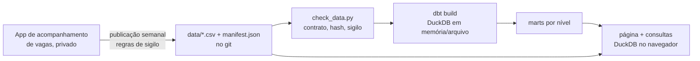

# Mercado de gestão de dados no Brasil

Dado aberto e pipeline reproduzível sobre vagas de **liderança em dados, analytics e IA no Brasil**, com foco em
**coordenação × gerência**: o que pedem, onde ficam, em que regime e o que se sabe (e o que não se sabe) sobre salário.

Os dados nascem de um app de acompanhamento de vagas que o autor desenvolveu. O app
guarda vagas de vários tipos; **este trabalho recorta só as de liderança em dados no Brasil**, e esse recorte é
publicado toda semana, de forma automática, neste repositório.

> **Leia os vieses abaixo antes de citar qualquer número daqui.** É a amostra de uma pessoa, não um retrato do mercado
> inteiro. Os números mudam a cada publicação; os valores vigentes estão em `data/manifest.json` (contagens e data de
> geração) e na página, nunca neste texto.

*English, in one line: an open, weekly-refreshed dataset of Brazilian data-leadership job postings (coordinator ×
manager level) with a dbt/DuckDB pipeline that runs in CI with no credentials. Methodology and biases below (in
Portuguese).*

## O que tem aqui

| pasta | o que é | quem escreve |
|---|---|---|
| `data/` | os CSVs do dataset (`vagas.csv`, `requisitos.csv`, `benchmarks.csv`, `rotulos.csv`) e o `manifest.json` | **só a automação de publicação**, 1 commit por publicação, semanal |
| `dbt/` | projeto dbt sobre DuckDB: staging lê `data/*.csv`, marts por nível, testes | código |
| `pipeline/` | Python: conferência do contrato e do sigilo (`check_data.py`) e o exemplo da rota alternativa de classificação | código |
| `site/` | a página pública (hoje um marcador; os números com a consulta ao lado entram depois) | código |
| `tests/fixtures/` | dados **fictícios** no mesmo formato, pra CI rodar antes da 1ª publicação | `pipeline/make_fixture.py` |
| `PLAN.md` | decisões do pipeline, com data e motivo | código |

Nada neste repo se conecta a banco. O dado é gerado fora, passa por regras de sigilo antes de virar commit, e o CI só
lê os arquivos do próprio repo.

## Arquitetura



**O que cada peça faz, e o que ela não faz**

- **Armazenamento: arquivos CSV em `data/`, versionados no git.** São poucos arquivos pequenos, e cada commit é um
  snapshot do dataset (o histórico dá a série temporal no futuro). Ninguém edita à mão.
- **Motor de consulta: DuckDB.** Ele lê os CSVs no lugar (`read_csv`) e materializa staging e marts num arquivo local
  (`dbt/target/mercado.duckdb`) que é **descartado e reconstruído do zero a cada execução**. Não é um banco
  persistente: o que persiste é o CSV. O volume (milhares de linhas, um escritor, rodada semanal) não pede mais que
  isso.
- **dbt: a camada de transformação sobre o DuckDB.** O adaptador `dbt-duckdb` compila os modelos SQL, resolve a ordem
  pelas dependências (`ref()`), roda os testes e documenta a linhagem. O DuckDB executa; o dbt organiza e testa.
- **Orquestração: GitHub Actions, encadeada por eventos.** A publicação semanal faz um commit em `data/`; esse commit
  dispara o workflow `pipeline` (confere o contrato e roda o `dbt build`) e o `pages`. A ordem *dentro* da
  transformação é o DAG do dbt. O que não existe é um orquestrador de ativos (Dagster, por exemplo): hoje há uma
  transformação e um encadeamento simples, e um orquestrador seria mais uma peça pra hospedar. A decisão é reavaliada
  quando entrar a etapa de classificação de requisitos por modelo de linguagem, que é o primeiro passo com custo,
  cache e reprocessamento parcial. Está registrada em `PLAN.md`.

## Classificação de requisitos: modelo e rota de consumo

Cada linha dos anúncios (responsabilidades, requisitos, diferenciais) recebe uma natureza e um conjunto de itens de uma
taxonomia fechada. Vários modelos foram medidos contra um conjunto de referência (rótulos de modelos revisados por pessoa;
método e ressalvas em `rotulagem/` e `evals/relatorio.md`). **O escolhido é o Claude Haiku 5.5**, pelo desempenho na
referência, e não por custo: nesse volume, todos os candidatos custam centavos.

**O consumo ocorre pela assinatura do Claude do autor, na cota semanal, e não por uma API paga.** É uma escolha de rota,
não uma limitação técnica: o mesmo trabalho roda por um gateway de modelos, com o mesmo prompt, esquema e validação.
`pipeline/exemplo_gateway.py` é um exemplo executável dessa rota alternativa (Vercel AI Gateway, protocolo da OpenAI,
custo informado por chamada). Quem quiser reproduzir a classificação sem assinatura pode usá-lo, com a própria chave.
Como a rota por assinatura é disparada e como o resultado volta ao repositório está em `PLAN.md`.

### O que sai da classificação, e o que não sai

`rotulos.csv` tem uma linha por linha de anúncio classificada: `id_publico`, `ordem` (posição da linha no anúncio),
`hash_linha` (identificador da linha, sem o texto), `secao` (responsabilidades, requisitos ou diferenciais), `natureza`
(`responsabilidade`, `requisito` ou `contexto`), `itens` (chaves da taxonomia separadas por `|`), `ferramentas`
(nomes das ferramentas citadas na linha, separados por `|`), `setor`, `versao_taxonomia` e `rotulador`. **O texto das linhas não é publicado**: o anúncio pertence à empresa, e o texto
que já está em `requisitos.csv` é um resumo dos requisitos, não o anúncio. Quem quiser relacionar um item ao texto
volta ao posting pela `url`.

**Método.** Uma chamada por vaga: o modelo recebe as linhas do anúncio inteiro, na ordem e com a seção, e devolve, para
cada linha, a natureza e **todos** os itens que ela pede (uma linha pode pedir vários; contexto sobre a empresa não pede
nenhum). A taxonomia (`rotulagem/taxonomia.md`, de onde sai o seed `dbt/seeds/taxonomia.csv`) é fechada: item fora
da lista é erro de validação, e o item `outro` é a válvula pra o que não cabe. Peso, anos de experiência e ferramentas
**não** vêm do modelo, e sim de regras determinísticas (`rotulagem/regras.py`, `dbt/seeds/ferramentas.csv`); delas, só as
ferramentas são publicadas, na coluna `ferramentas` (o nome canônico, nunca o texto da linha). O modelo só decide o que
exige leitura. A taxonomia tem uma versão (hash do arquivo): taxonomia nova refaz a rodada inteira, e
só uma versão fica publicada por vez.

**Vieses e limites da classificação.**
- **Mede-se contra uma referência, e a referência não é verdade absoluta.** São rótulos feitos por um modelo maior e
  revisados por uma pessoa em um conjunto de vagas. O desempenho do modelo escolhido (F1, precisão e revocação por
  item) está em `evals/relatorio.md`, e o conjunto exato de itens de uma linha concorda com a referência em cerca de
  60% das linhas. Item a item a concordância é maior; linha a linha, não: **conte vagas por item, não confie numa linha
  isolada.**
- **Revocação menor que precisão.** O modelo tende a deixar de marcar um item que está lá mais do que a marcar um que
  não está. Contagens por item são piso, não teto.
- **Ferramenta é citação, não exigência.** A regra procura o nome (e apelidos como "PBI", "PySpark") em qualquer
  linha do anúncio, inclusive diferencial, lista de exemplos e texto de contexto, e não entende o sentido: "não precisa saber Python" conta.
  Quem pede a ferramenta por outro termo ("linguagem de programação", "nuvem") não é contado. A contagem é piso. O
  dicionário (`dbt/seeds/ferramentas.csv`) tem versão: mudou, as linhas são recalculadas antes da publicação.
- **Itens de fronteira confundem.** A taxonomia lista, item a item, o que *não* conta; mesmo assim a borda entre itens
  vizinhos (liderar projetos × liderar time, por exemplo) é onde mais se erra.
- **Rodada parcial é estado normal.** A fração classificada fica em `cobertura` no `manifest.json` (linhas do anúncio ×
  linhas classificadas); o teste `rotulos_cobertura_baixa` avisa sem derrubar a CI. Analise só com cobertura completa,
  ou diga a fração junto do número.

**Modelo e custo.** O modelo é o **Claude Haiku 5.5**, consumido pela assinatura do autor, sem API paga (seção
anterior). A escolha vem do desempenho na referência. Nada no repositório público guarda credencial: a classificação
roda do lado privado e só os rótulos validados chegam aqui. O dbt confere que todo item pertence à taxonomia, que a
natureza está na lista, que linha de contexto não carrega item, que o setor só aparece junto do item de setor e que
cada `id_publico` existe em `vagas.csv`. `mart_vaga_item` (vaga × item) e `mart_vaga_ferramenta` (vaga × ferramenta)
são a base das contagens da análise; `analise/achados.md` é refeito pela CI a cada publicação.

## Como a amostra foi formada (metodologia)

1. **Coleta.** Cada vaga entra no app por link ou texto colado (LinkedIn, Gupy, InHire e outros portais) e é lida e
   analisada uma a uma: requisitos do posting, regime, local e a pesquisa de salário de mercado. A coleta começou em
   setembro de 2026 e continua.
2. **Recorte.** O app olha vagas de vários tipos e países. Para este trabalho entram **somente vagas de liderança em
   dados, analytics e IA no Brasil**, ou seja, cargos cujo posting pede gestão de pessoas, em qualquer situação da vaga
   (inclusive as que já saíram do ar) e desde que tenham passado pela leitura completa. Vagas técnicas sem gestão de
   pessoas, vagas fora do Brasil e vagas ainda não lidas ficam de fora.
3. **Nível.** Coordenador × gerente, pelo **título**, por regra determinística (`dbt/seeds/niveis.csv`, a primeira
   regra que casa vence). Head e diretoria ficam num bucket "alta gestão", citados sem quebra; o que não é gestão de
   dados (gestão de time de software ou de produto, por exemplo) fica em "outros". Sem modelo de linguagem: o nível é a
   chave da análise e precisa dar o mesmo resultado em qualquer máquina.
4. **Requisitos.** Em `requisitos.csv`, a lista de requisitos que o app de acompanhamento resume de cada anúncio, sem
   nota nem interpretação. O texto vem do anúncio, mas **não é o anúncio inteiro**: parte das linhas foi encurtada
   (termina em "…") ou junta vários pedidos numa linha só (separados por "·"), e nem todo tópico do anúncio entra.
   Contagem feita sobre esse arquivo é piso. A classificação por item (ferramenta, competência de gestão, idioma…)
   não sai deste arquivo: ela é feita sobre as linhas do anúncio inteiro e publicada em `rotulos.csv`, descrito na
   seção seguinte.
5. **Salário, em duas camadas que não se misturam.** (a) *Transparência do posting*: quantas vagas declaram faixa,
   medida pelas colunas `salario_*` e `faixa_posting`. (b) *Benchmark pesquisado*: fontes públicas de salário por cargo
   e cidade, uma linha por fonte em `benchmarks.csv`. **Benchmark não é o que a vaga paga.** Parte dessas fontes
   (Glassdoor, por exemplo) bloqueia leitura automática, e o valor veio de resumo de busca: trate cada fonte como
   indício, não como medida.
6. **Colunas derivadas.** `regime`, `cidade`, `uf`, `contrato` e `salario_*` são lidos do posting e **derivados na
   análise**, não campos estruturados do portal. Regra de regime: posting que cita cidade ou estado e não diz "remoto"
   conta como híbrido ou presencial.
7. **Normalização na publicação.** `fonte` vira o canal (`linkedin`, `gupy`…), `contrato` vira `CLT`, `PJ` ou vazio e
   `salario_tipo` vira `base`, `total` ou vazio. O texto livre original não sai.

## Vieses e limites (o que impede de ler isto como "o mercado")

- **Amostra de uma pessoa, não do mercado.** As vagas são as que apareceram na busca e na rede de uma só pessoa. Não é
  sorteio, não é censo.
- **Janela curta e crescente.** A coleta começou em setembro de 2026. Com poucas semanas de dados, **não há tendência**,
  só retrato do período acumulado; série temporal só depois de meses de snapshots em `data/`.
- **A distribuição geográfica não é representativa.** Ela não tem a intenção de refletir a distribuição nacional: mostra
  apenas a preferência de busca do autor. Por isso **não recomendamos análises extensas pela localização da vaga**; o
  principal fato de análise deste dataset é a **composição dos requisitos**.
- **Só vagas lidas por completo.** Uma vaga que chegou ao app e não foi analisada não está aqui.
- **Nível pelo título.** Títulos variam por empresa (um "Tech Manager" pode ser coordenação). As exceções resolvidas à
  mão estão em `niveis.csv`, cada uma com o motivo na coluna `nota`.
- **Postings expiram.** A `url` é a do dia da captura; as do LinkedIn costumam sair do ar. O texto do requisito
  continua aqui.
- **n pequeno por fatia.** Quebrar por nível (ou por qualquer outra dimensão) deixa fatias de poucas vagas. Todo número publicado deve
  carregar o tamanho da amostra ao lado.
- **Empresas nomeadas.** As empresas aparecem pelo nome, como nos postings públicos. Nenhum dado pessoal da busca
  (candidaturas, resultados, avaliações) sai do app.

## Contrato de dados (v1)

Cada arquivo é CSV UTF-8, RFC 4180, `\n`, cabeçalho sempre, célula vazia = ausente. `manifest.json` traz a versão do
contrato, a data de geração, as contagens, a `cobertura` da classificação e o sha256 de cada arquivo; `pipeline/check_data.py` confere tudo isso.

- `vagas.csv` (1 linha por vaga): `id_publico` (12 hex do sha256 da URL normalizada), `empresa`, `cargo_oficial`, `modo`,
  `geografia`, `regime`, `cidade`, `uf`, `contrato`, `fonte`, `candidatura_tipo`, `mes`, `url`, `faixa_posting`,
  `salario_min`, `salario_max`, `salario_moeda`, `salario_tipo`. `modo` e `geografia` descrevem o recorte (liderança,
  Brasil) e hoje têm um único valor; `candidatura_tipo` só se aplica a vagas do LinkedIn (onde fica o formulário de
  candidatura); `mes` é o mês de publicação ou, na falta dele, da captura.
- `requisitos.csv` (1 linha por linha de requisito): `id_publico`, `ordem`, `texto`.
- `benchmarks.csv` (1 linha por fonte de benchmark): `id_publico`, `ordem`, `fonte_url`, `fonte_nota`.
- `rotulos.csv` (1 linha por linha de anúncio classificada, sem o texto): `id_publico`, `ordem`, `hash_linha`, `secao`,
  `natureza`, `itens` (separados por `|`), `ferramentas` (nomes do dicionário, separados por `|`), `setor`,
  `versao_taxonomia`, `rotulador`.

Mudança de coluna sobe a versão do contrato. A publicação e este repo concordam sobre a lista; se discordarem, o
`check_data.py` falha.

## Rodando localmente

```bash
python -m venv .venv && .venv/Scripts/pip install -r requirements.txt   # no Linux/macOS: .venv/bin/pip
python pipeline/check_data.py data                                      # contrato, manifest e sigilo
dbt build --project-dir dbt --profiles-dir dbt                          # DuckDB, sem credencial
```

Sem `data/` completo (antes da publicação que traz `rotulos.csv`), aponte pros dados fictícios:
`dbt build --project-dir dbt --profiles-dir dbt --vars '{data_dir: tests/fixtures}'`.

## Licença

- **Dado** (`data/`, `dbt/seeds/`): [CC BY 4.0](LICENSE-DATA). Pode usar, inclusive comercialmente, citando a fonte. O
  texto de cada posting continua sendo da empresa que o publicou.
- **Código** (`pipeline/`, `dbt/`, `site/`, `.github/`): [MIT](LICENSE).

Como citar: *Fernando Guimarães, "Mercado de gestão de dados no Brasil" (nandodsg/mercado-gestao-dados-br), CC BY 4.0.*
